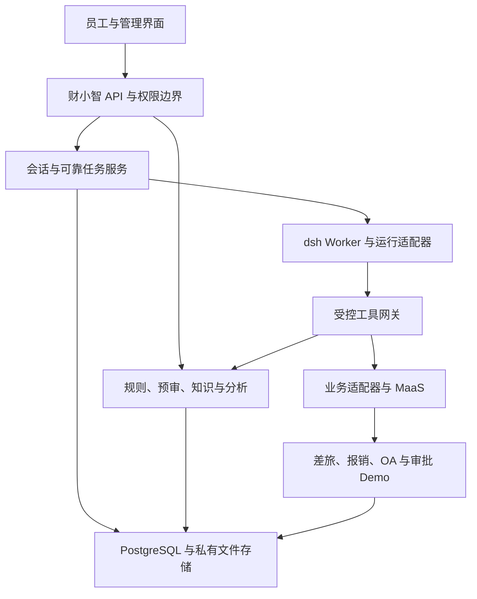

# 财小智 v1 总体架构与公共契约

版本：1.0｜设计日期：2026-11-05｜用途：本设计包所有模块的共同开发约束。

## 1. 交付目标与边界

建设一个以对话为入口、以概要卡片引导、以右侧抽屉完成详细处理的 B/S 财务个人助理。普通员工准备单据并查进度；主管筛选风险并审批；财务核查异常、管理规则和分析数据。Agent 由 dsh 承担模型交互和工具调度；身份、业务权限、可靠任务、规则、数据及审批状态由财小智服务端负责。

本包是产品与开发详设，不是已实现系统，也不意味着满足公司生产准入。所有金额标准和人员数据均为演示夹具，不是现行公司制度或法定标准。

| 深度 | 模块 | 本期要求 |
|---|---|---|
| 产品级设计 | M01–M07、M13–M14 | 持久化、权限隔离、版本化、真实工具调用、失败恢复、可观察与验收；不能用固定对话代替业务逻辑 |
| 简易可运行 Demo | M08–M12、M15 | 简化页面、审批链和外部提供方，但必须真实保存状态、检查版本权限、返回回执，支持跨模块联调 |

不做：支付、银行打款、总账记账、完整 ERP/OA、通用低代码工作流设计器、任意上传代码执行、未经配置的公网检索、全公司聊天内容无差别入库、多 Agent 自主审批。财务服务工单独立系统、复杂补料协同、多币种折算留到后续；本期用退回理由、材料更新和站内消息完成基础闭环。

## 2. 系统形态与技术基线

建议采用 TypeScript 模块化单体 API 加独立 Agent Worker；不是每个模块部署一个微服务。业务模块先共享 PostgreSQL，不共享私有表的写权限；通过应用服务调用。后续替换支撑系统，只替换适配器。

| 层 | 基线选择 | 约束 |
|---|---|---|
| 前端 | React + TypeScript + Vite；组件、样式令牌统一 | 浏览器不存模型密钥，不直接连接 dsh，不以 localStorage 作为业务数据库 |
| API | Node.js + TypeScript + Fastify；JSON Schema/Zod 边界校验 | HTTP 契约优先，前后端从 packages/contracts 引用同一类型 |
| 数据 | PostgreSQL；SQL migration + Drizzle | 金额与聚合不能依赖模型计算；所有资源有 tenant_id |
| 队列 | PostgreSQL durable job/outbox；Redis 仅用于唤醒、缓存和限流 | Redis 丢失不能丢任务；可先不用 Redis |
| Agent | dsh TypeScript SDK + 自定义受控 profile + AgentRuntimeAdapter | 首个技术验证锁定 dsh/SDK 同版本及运行时依赖，不在本文虚构具体版本号 |
| 文件 | 开发用 S3 兼容私有对象存储；生产接公司对象存储 | 数据库保存元数据与权限；首期下载/预览统一鉴权代理，上传可用短时授权 |
| 流式 | SSE + 持久事件游标；HTTP 提交命令 | 断线不意味着任务取消，刷新后可恢复 |
| 验证 | Vitest 单元/契约测试 + Playwright 关键旅程 | 真实模型集成测试与确定性业务测试分开运行 |

工程初始化时在 lockfile、容器镜像和 docs/runtime-compatibility.md 固定精确依赖。这里的技术选择是本项目决策，并非 dsh 自带企业平台的声明。



## 3. 仓库布局与模块责任

```text
apps/web/src/features/{assistant,memory,rules,preaudit,skills,knowledge,analytics,travel,expenses,oa,approvals,identity,integrations,operations,demo}
apps/api/src/modules/{同名模块}
apps/worker/src/{runner,scheduler,reconciler}
packages/contracts/src/{common,events,cards,各模块}.ts
packages/agent-runtime/src/{adapter,dsh,context,policy}
packages/business-adapters/src/{ports,demo,maas}
packages/action-service/src/{prepare,confirm,execute,reconcile,cancel,registry}
packages/jobs/src/{queue,lease,outbox}
packages/fixtures/src/{seed,scenarios,clock}
tests/{contracts,integration,e2e,load}
infra/{compose,migrations,profiles}
docs/{decisions,runbooks,contracts}
```

目录是交付约定；开发者可按职责再拆文件。禁止复制一份“聊天单据表”与一份“业务系统单据表”。旧 HTML 原型只能复用布局、文案与视觉，不继承其内存模拟状态为正式数据源。

| 模块 | 数据所有者 | 公开 API 前缀（均加 /api/v1） |
|---|---|---|
| M01 | threads、messages、cards、drawer bindings | /threads、/home、/cards |
| M02 | memories、subscriptions、inbox | /memories、/subscriptions、/inbox |
| M03 | rule definitions、versions、field mappings、tests | /rules、/rule-mappings |
| M04 | preaudit tasks、results、findings | /preaudit |
| M05 | skills、versions、grants、invocations | /skills |
| M06 | policies、chunks、citations、clarifications | /knowledge |
| M07 | metric catalog、analysis snapshots、reports | /analytics |
| M08 | travel requests、legs | /travel |
| M09 | invoices、expense items、claims | /expenses |
| M10 | entertainment requests、demo messages | /oa |
| M11 | approval tasks、decisions、action receipts | /approvals、/actions、/confirmations |
| M12 | identities、organizations、grants、master data | /auth、/me、/directory、/master-data |
| M13 | capabilities、connectors、tool bindings、call logs | /integrations |
| M14 | runs、run events、leases、checkpoints、budgets | /runs、/operations |
| M15 | demo environments、seed manifests、faults | /demo |

消息领域区分：M01 是对话消息；M02 是 Agent 主动消息收件箱；M10 是模拟 OA 业务通知。三者可互相引用，不相互冒充数据所有者。

## 4. 身份、角色与权限

服务端从 HttpOnly、Secure、SameSite 会话 Cookie 解析身份；写请求需要 CSRF 防护。API 忽略浏览器和模型传入的 user_id/tenant_id/roles 作为授权依据。Worker 获取短时、限作用域的执行上下文，不拿用户明文凭据。

```ts
type ActorContext = {
  tenant_id: string;
  user_id: string;
  roles: Array<'employee'|'manager'|'finance'|'platform_admin'>;
  department_ids: string[];
  permissions: string[];
  authz_version: number;
  session_id: string | null;
  invocation_origin: 'interactive'|'subscription';
  delegation_id: string | null;
}; // 仅服务端构造，永不由 LLM 自报
```

角色是能力集合的起点；实际授权需要 action、resource、scope 三者匹配。平台管理员默认没有读取员工报销、会话、记忆和附件的权限。知识、Skill、报告分别授权；“可以调用 Skill”不等于“可以读其源码或访问其所用全部数据”。

每次取数、下钻、下载、流式订阅、工具执行和确认执行均重新鉴权。列表、缓存、向量检索先过滤授权范围；禁止先取全量再让模型隐藏。租户/用户/权限版本必须进入缓存 key。身份切换清空前端缓存、断开旧 SSE，旧 Worker 凭据按撤权规则失效。

交互请求的 session_id 非空、invocation_origin=interactive。日程运行的 session_id=null、invocation_origin=subscription，delegation_id 指向用户明确启用的订阅授权；运行时与当前权限取交集，只允许订阅白名单内只读能力。用户退出浏览器不删除有效订阅；停用用户、撤销授权或暂停订阅立即停止后续读取/投递。无会话的后台身份不能确认写入。

首期权限名在 packages/contracts/src/permissions.ts 唯一导出；不得另造 analytics.read/rules.company.manage/demo.manage 等同义名称：

| 权限组 | 固定名称 | 范围约束 |
|---|---|---|
| 本人业务读写 | travel.read.own、travel.write.own、expense.read.own、expense.write.own、oa.read.own、oa.write.own | owner 为本人，状态与领域校验仍生效 |
| 部门业务读取 | travel.read.department、expense.read.department、oa.read.department | 显式部门集合；附件另检查父对象授权 |
| 审批 | approval.decide | 当前任务 assigned_to、节点/资源类型和范围三者匹配 |
| 规则 | rule.manage.personal、rule.manage.company | 本人规则或明确公司组织管理范围 |
| Skill | skill.use、skill.manage | use/source_read/maintain/review/publish 资源授权分开 |
| 制度与分析 | knowledge.manage、analytics.query、analytics.export | 制度范围、指标/维度/导出范围独立 |
| 平台 | integration.manage、operations.read、operations.manage、identity.grant.manage、demo.control | 元数据/配置授权不自动授予业务内容读取 |

模块可细化资源动作，但新增平台权限必须更新此表和统一 schema。用户对本人会话/记忆/日程的管理仍由 owner 与有效身份限制，不授予读取其他人的权限。

## 5. 统一数据与接口格式

### 5.1 公共字段

所有业务对象包含 id、tenant_id、version（从 1 递增整数）、created_at、updated_at；涉及归属另含 owner_id。外部系统的 external_id 独立保存，不能替代内部主键。时间戳 RFC3339 UTC；业务日期 YYYY-MM-DD；默认时区 Asia/Shanghai，调度按用户时区。演示业务基准日 2026-11-05，不改变服务器真实时间。

金额统一 Money = { amount_minor: string, currency: 'CNY' }；整数分用十进制字符串，服务端用 bigint/decimal 运算。例 1,200.00 元为 `{"amount_minor":"120000","currency":"CNY"}`。百分比、数量用显式 decimal string，不能混成金额。首期只支持人民币；不静默换汇。

分页 `?cursor=...&limit=20`，最大 100；稳定排序至少包含 id；返回 next_cursor。集合字段为空用 []，未知值用 null，0 有明确数值意义。文案全中文，技术枚举英文。

### 5.2 响应与错误

```json
{"data":{"id":"clm-001","version":3},"meta":{"request_id":"req-1","trace_id":"tr-1","server_time":"2026-11-05T01:00:00Z","data_mode":"demo"}}
```

```json
{"error":{"code":"VERSION_CONFLICT","message":"单据已更新，请刷新后再操作。","retryable":false,"details":{"current_version":4}},"meta":{"request_id":"req-2","trace_id":"tr-2"}}
```

错误码：VALIDATION_ERROR(400)、UNAUTHENTICATED(401)、FORBIDDEN(403)、NOT_FOUND(404)、VERSION_CONFLICT/IDEMPOTENCY_CONFLICT/INVALID_STATE/CONFIRMATION_EXPIRED/REVALIDATION_REQUIRED(409)、RATE_LIMITED(429)、DEPENDENCY_UNAVAILABLE(503)、OUTCOME_UNKNOWN(202 对应待核实任务)。资源不存在与无权枚举统一对外 404；已授权资源上的动作权限不足为 403。绝不向用户返回 SQL、密钥、文件物理路径或无权对象名称。

所有修改接口使用 Idempotency-Key；业务更新请求体携带 expected_version。相同 key + 相同归一化 payload 返回原结果；相同 key + 不同 payload 拒绝。key 的作用域为 tenant + actor + operation；保存写操作账本至少 180 天，本期默认 180 天、可按公司要求延长。

### 5.3 资源引用、动作回执

```ts
type ResourceRef = {
  type: 'travel'|'expense_claim'|'oa_request'|'rule'|'skill'|'policy'|'analysis'|'report';
  id: string;
  version: number;
};
type ActionReceipt = {
  id: string; action_id: string; idempotency_key: string;
  outcome: 'succeeded'|'rejected'|'failed'|'unknown';
  resource: ResourceRef | null;
  external_receipt_id: string | null;
  occurred_at: string; data_mode: 'demo'|'production';
  error_code: string | null;
};
```

异步成功先返回 202 + task/run/action id；不能显示“已审批”。只有业务适配器核验成功回执，才更新对应成功状态。超时无法知道对端是否已写入时，保留 unknown，走查询回执核实，不直接重复提交。

## 6. 状态机必须分层

| 对象 | 固定枚举 | 说明 |
|---|---|---|
| Agent run | queued/running/waiting_user/waiting_confirmation/reconciling/succeeded/failed/cancelled/interrupted | paused 需求分别归入等待用户或确认；需要显式恢复的中断为 interrupted |
| 预审任务 | queued/running/completed/partial_failed/failed/cancelled | 完成只说明检查结束 |
| 预审单据处理 | pending/running/completed/failed/stale | stale 指绑定版本失效 |
| 风险展示分组 | risk/incomplete/attention/low | 顺序是分组优先级，并不删除次要发现 |
| 差旅与 OA | draft/pending_manager/approved/returned/withdrawn | 不产生付款状态 |
| 报销 | draft/pending_manager/pending_finance/completed/returned/withdrawn | completed 表示审批完成，绝不表示已付款 |
| 审批任务 | pending/approved/returned/cancelled | 与单据当前节点一致 |
| 通用动作 | prepared/confirmed/executing/succeeded/rejected/failed/unknown/cancelled/expired | actions 是写入账本，不等于 Agent run |

用户取消只能停止未执行的后续步骤，不能撤销已完成业务动作。执行中写入遇到取消，先核实结果再展示；不得显示 cancelled 而掩盖成功审批。子批次完成部分成功时，父 run 可 succeeded（已产出完整部分成功报告），业务结果明确列每项，不假装全部成功。

## 7. 确认、并发和统一写入边界

提交、审批、退回、规则启用/发布、共享 Skill 发布、业务通知发送、报告对外分发必须显式确认。保存 AI 草稿建议采用“查看差异 → 采纳选中项”；手工保存表单本身即明确提交保存指令。读取、预审、草稿生成不弹审批式确认。简单个人记忆以用户明确“记住”或界面保存作为授权，M02 定义回执和撤销。

同一个确认框中展示对象、版本、动作、金额/范围、接收人（如有）和影响。服务端创建 confirmation，内容绑定 actor、authz_version、action、归一化 args hash、resource versions、rule/skill/capability versions（适用时）、expires_at，默认 10 分钟。模型不能生成确认 token；浏览器点击调用确认端点。

通用接口：`POST /confirmations` 创建动作意图；`GET /confirmations/{id}` 由本人交互会话读取摘要和服务端短时签名 confirmation_token；`POST /confirmations/{id}/confirm` 提交 expected_version、summary_hash、confirmation_token 并交给动作服务；`GET /actions/{id}` 读取回执。token 绑定 actor/action/hash/expiry，工具只返回确认 ID/摘要、不返回执行凭证。可在业务 UI 暴露快捷按钮，但所有有影响动作通过同一应用服务验证，禁止 Agent 接口和业务页面各写一套逻辑。共享执行器属于公共平台，由 M11 在第一个业务写入里落地，M13 调用。

每次执行前检查当前权限、对象版本、状态、确认范围、有效性与幂等账本。旧卡片/旧确认只允许刷新，不自动扩大到新增单据。批量审批每项独立提交、独立回执；已成功项不能因其他项失败回滚为未执行。选择范围改变必须重新确认。

## 8. 对话、卡片与抽屉协议

卡片由服务端使用可信业务数据构建；LLM 仅提供经过 schema 校验的文案/意图，不输出任意 HTML/JS。卡片类型固定为 todo_summary、preaudit_summary、document_summary、draft_proposal、rule_proposal、policy_answer、analysis_result、report_result、skill_result、action_result、reminder_summary。

```ts
type AgentCard = {
  id: string; schema_version: 1; type: string;
  thread_id: string; message_id: string; run_id: string | null;
  title: string; summary: string; snapshot_at: string;
  resource_refs: ResourceRef[];
  payload: Record<string, unknown>; // 按 type 单独 schema，不是自由结构
  actions: Array<{id:string; label:string; kind:'open_drawer'|'continue_chat'|'prepare_action'|'open_source'; target:string}>;
  revision: number; stale: boolean;
};
```

抽屉 URL 状态以 `?drawer=<type>&resource=<id>` 表达，可刷新恢复；加载时读取最新对象并鉴权。关闭抽屉保留对话与滚动位置，继续追问带 explicit resource_ref，不让模型猜“这张”是哪张。桌面默认 560–720 px，可扩展至主区宽度的 70%；窄屏转全屏面板。保存/确认不能要求用户在聊天框再输入同样内容。

首页是输入框、常用任务和待办数字；首次打开不自动创建会话或塞入预审卡。用户点击待办/消息，才开启或续接对话，生成概要卡并可展开抽屉。定时摘要进入 M02 收件箱及未读数，不打断当前输入。

## 9. Agent 任务、工具与事件边界

每个用户拥有逻辑独立的会话、记忆和工作空间；不是给每名员工常驻启动一套 dsh。v1 采用按需分配独占运行槽，每个活跃 run 独占其 dsh 子进程；等待人工确认期间持久化 checkpoint 并释放槽。允许之后优化进程复用，但不得降低隔离和取消语义。

同一 thread 同时最多一个非终结 run（包括等待状态）；新输入在等待状态应当用于续接或修改该任务，若需新任务须取消/完成当前任务或另开会话。每用户跨会话最多 2 个正在占用 dsh 执行槽的 run，租户执行槽配额默认 20；每用户未终结任务最多 10 个（含排队与等待），公平排队。数值为初始配置，不是已测容量承诺。

run.origin 固定 conversation/subscription。交互 run 必有 thread_id 和 input_message_id；订阅 run 的二者为 null、必须有 occurrence_id，按 occurrence 唯一创建，不提前创建隐藏会话。后台 run 同样消耗配额、保存事件和回执，完成后进入 M02 收件箱；用户点开才创建 M01 对话。后台运行不足以判断时产出失败/待调整说明，不进入等待审批。

另有不调用 Agent 循环的领域作业：票据 OCR、知识导入、预审 item、消息投递、文件导出等。它们使用公共 packages/jobs 的 durable_jobs/租约/outbox 能力，保存 job_id 和所属领域 task_id；可有 origin_run_id 关联发起它的 Agent，但不能为了异步处理强造一个新 Agent run。独立页面轮询领域任务接口，Agent 对话通过已绑定 run 的 card.upsert 或刷新资源获取进度。run_jobs 是 Agent 专用调度队列；普通 durable_jobs 不占用 dsh 模型槽。

模型可选择只读工具和提出写入意图；权威权限来自 server-side ActorContext。工具网关拥有以下固定公共接口：

```ts
type ToolRequest = {name:string; version:string; arguments:unknown; run_id:string; call_id:string};
type ToolResult = {
  status:'ok'|'requires_input'|'requires_confirmation'|'rejected'|'error'|'unknown';
  data:unknown; evidence_refs:string[]; action_id:string|null; error_code:string|null;
};
// dispatchTool(request, context) 由服务端执行；模型不传身份与凭据。
```

工具命名沿用模块语义：finance.todo.list、finance.document.get、finance.preaudit.start、finance.preaudit.get、finance.rules.propose、finance.rules.test、finance.knowledge.search、finance.analytics.query、finance.report.create、finance.travel.propose_patch、finance.expense.propose_patch、finance.action.prepare、finance.action.status。其他工具由 M13 注册、冻结 schema 后增加，不在 prompt 里拼任意 URL。

SSE：`GET /runs/{id}/events?after=<seq>`；支持 Last-Event-ID。事件是 `{run_id,seq,type,occurred_at,payload}`，seq 单 run 单调递增，客户端按 (run_id,seq) 去重。固定类型：run.status、assistant.delta、assistant.message、tool.started、tool.completed、card.upsert、confirmation.required、usage.updated、run.error。持久化可批量合并文本 delta；最终 assistant.message 为完整文本。不给用户展示隐藏思维链；只展示正在查询/检查的简洁步骤和结果证据。

M14 定义超时、取消、恢复、配额、模型协议和运行适配器；M01 只依赖平台事件，不依赖 dsh 私有消息结构。

## 10. 规则、预审与审批的共同语义

规则类别固定 invoice/transport/lodging/meals/itinerary/general。公司规则可产生明确违规或缺失；个人规则只提高关注度，不能豁免公司规则或自动拒绝。SRS 接收结构化标准 JSON；OCR 与原始附件识别属于 M09。

预审绑定 document version、材料版本、公司规则集版本、所选个人规则版本、字段映射版本及 reviewer scope。分组：明确违规为 risk；没有明确违规但关键项无法判断为 incomplete；前两者皆无且命中个人提醒为 attention；所有必查覆盖且无命中才为 low。

低风险不等于系统代替用户审批。仅满足当前人有当前节点审批权、所有必查完成、版本未变、无 attention/risk/incomplete 时 eligible_for_bulk_approval=true。M11 执行时重新校验并验证预审结果归属当前审核人；不能使用其他人的低风险结论绕过自己的个人规则。

## 11. 分析与业务口径

默认“报销金额”按单据审批完成日期统计 completed 的报销含税金额，不代表付款。若用户问“今天提交多少”，必须使用 submitted_at 及提交口径，另行展示撤回/退回是否排除。指标由 M07 明确定义，不让模型自造 SQL 或改统计口径。

图表、报告、下钻使用同一 analysis snapshot 和筛选摘要。金额使用整数分汇总；缺失、零、空结果分别展示。个人只查本人；主管只查显式授权部门；财务按数据范围授权。报告导出另需 analytics.export，不因可看图表自动可下载明细。

## 12. 文件、审计与保留

文件先登记再上传到私有临时区，校验 MIME/大小/内容再完成；未完成文件不参与检索或执行。预览和下载每次通过服务端代理鉴权，不下发可绕过撤权检查的直接对象读取链接；上传短时授权仅限指定临时对象和大小。禁止对外永久公开 URL。详情见 M06/M09。附件内容、网页、Skill 文本均属不可信输入，不能覆盖系统权限和执行策略。

审计至少记录 actor、resource refs、action、confirm id、before/after version、result、trace/run id、发生时间；原始隐私字段按必要性脱敏。业务审批日志追加，不因删除会话而删除。

开发默认：对话/运行内容 90 天，SSE 可回放事件 7 天，工作临时文件 24 小时，个人记忆保留到用户删除，软删除会话/记忆从后续上下文立即移除、30 天内清理可删除内容；备份按部署保留策略到期清除。财务审计/单据法定保存期限由公司确定，Demo 不宣称满足档案制度。管理员查诊断默认只见元数据；受控排障内容授权独立记录。

## 13. 演示夹具的固定关键数据

租户 t-demo；销售部 dept-sales、技术部 dept-tech。李娜 u-li、王强 u-wang 属销售；张伟 u-zhang 是销售主管；刘敏 u-liu 是获授权财务；赵磊 u-zhao 是平台管理员无业务读权；陈杰 u-chen 属技术，主管孙静 u-sun。

销售主管初始有 5 张待审报销，共 5,540.00 元：

| ID | 员工 | 金额（元） | 分组 | 原因 |
|---|---|---:|---|---|
| clm-001 | 王强 | 680.00 | low | 交通费，必查完整 |
| clm-002 | 李娜 | 1,200.00 | attention | 餐饮已关联有效 OA，仅命中张伟个人“餐饮费超过 1,000 元提醒” |
| clm-003 | 王强 | 2,200.00 | risk | 演示住宿标准 800 元/间夜，单据 2 间夜、1,100 元/间夜 |
| clm-004 | 李娜 | 900.00 | incomplete | 缺关键票据信息，不能判低风险 |
| clm-005 | 王强 | 560.00 | low | 办公费，必查完整 |

技术部 clm-006 陈杰 300.00 元 pending_manager，对张伟不可见。clm-007 李娜 3,500.00 元、clm-008 王强 2,400.00 元于 2026-11-05 completed；clm-009 李娜 1,000.00 元、clm-010 王强 800.00 元于 2026-10-05 completed；clm-011 陈杰 5,000.00 元于 2026-11-05 completed。完整字段与指标结果由 02 文档唯一维护。

基准预审：2 张 low 合计 1,240.00 元；1 attention、1 risk、1 incomplete。成功批量审批 clm-001、clm-005 后转 pending_finance；张伟剩余 3 张，刘敏新增 2 张财务待审；completed 指标总额尚不增加。

## 14. dsh 已验证事实与项目承担的部分

官方参考将 dsh 描述为可组合插件运行时，并提供 SDK profile；本项目选择自己的 Web 产品和 SDK 适配层。官方持久层文档描述 JSONL 提供方、单写入者和 flush 持久屏障；因此，财小智单独维护业务任务与动作账本，不把会话恢复等同于财务写入恢复。Skills 的产品级发布、范围授权、审查与版本治理由 M05 实现。

实施前做有退出标准的兼容验证：模型网关、工具注入、流式通知、持久化/续接、进程取消、受控 profile、运行目录隔离。SDK 方法及其可用性以锁定版本为准；本文出现的 AgentRuntimeAdapter 是项目自定义接口，不声称是 dsh 原生 API。

一手参考（查阅日期 2026-11-05）：

- https://deepseek-harness.github.io/deepseek-harness/en/reference/
- https://github.com/deepseek-ai/deepseek-harness/blob/master/packages/sdk/client/README.md
- https://deepseek-harness.github.io/deepseek-harness/en/reference/subsystems/persistence
- https://deepseek-harness.github.io/deepseek-harness/en/reference/subsystems/skills

## 15. 冲突解决与完成定义

文档优先级：本公共契约 > 模块文档明确领域规则 > 联调夹具与用例 > 实施步骤。发现冲突应先更新共同契约及相关测试，不能在模块里静默另定义枚举、状态和金额结构。需求变化记录 ADR，涉及其他模块时一并迁移。

每模块完成需：界面可操作、API 与 schema 一致、数据可刷新持久、权限/状态/异常用例通过、提供启动与演示说明、没有虚假成功回执。产品模块还需有超时与恢复、审计和故障诊断。支撑 Demo 也必须可替换，适配器不得将 demo 环境管理员特权传到生产。
