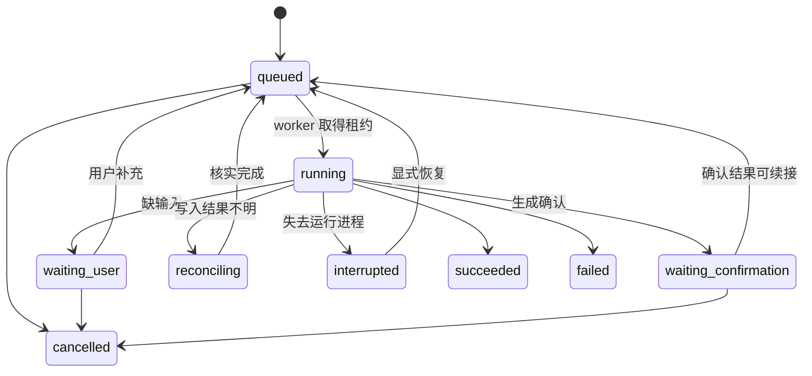

# M14 dsh 运行底座、可靠任务与运维

版本：1.0｜建设深度：产品级｜前置阅读：[公共契约](01_总体架构与公共契约.md)。

## 1. 模块目标与边界

提供真正可运行的服务端 Agent：接收用户任务，构建授权上下文，调用 dsh，调度工具，流式输出，暂停等待人，跨刷新和进程重启恢复。把个人会话和记忆映射到独立逻辑空间，把有限的计算资源按需分配给活跃任务。

dsh 负责模型与工具循环；本模块负责企业产品的运行控制。财务规则判断由 M03/M04、写入确认和回执由 M11、工具权限由 M13、个人记忆由 M02 负责。不能让一个大 prompt 同时承担身份、规则引擎、审批状态机和可靠任务队列。

本模块必须真实接入选定内网模型与 dsh。测试可以使用 FakeRuntimeAdapter，但系统只在明确 test 模式启用；没有真实模型配置时产品显示“模型服务未配置”，不伪造智能答案。

### 1.1 依赖与交付

- 输入：M12 ActorContext、M01 消息与资源引用、M02 记忆、M05 已校验且本人激活的私人 Skill 版本或已获使用权的共享发布版本、M13 工具目录和网关。
- 输出：run 状态、可重放事件、结构化结果、工具/成本记录、恢复入口、运维视图。
- M01 不依赖 dsh 的原生事件格式；所有事件由本模块转成公共协议。
- 初期单地区、单 PostgreSQL 主库，可多 API 实例和多个 Worker；跨地区容灾另行规划。

## 2. 功能需求

| 编号 | 要求 | 核心判定 |
|---|---|---|
| RUN-01 | 创建和排队 | 先落库再确认接收；HTTP 重试不重复创建 |
| RUN-02 | 独立上下文 | 会话、记忆、文件、工具凭据不跨用户 |
| RUN-03 | dsh 实际运行 | 可连续多轮工具调用并产生可核验结果 |
| RUN-04 | 流式和断线恢复 | 刷新后状态与最终消息一致、不重复卡片 |
| RUN-05 | 人工等待 | checkpoint 后释放运行槽；无人在场不持有模型循环 |
| RUN-06 | 取消与配额 | 取消仅影响该 run；预算达限不继续无限循环 |
| RUN-07 | 崩溃恢复 | 能识别已完成工具、未执行步骤和结果不明写入 |
| RUN-08 | 权限动态复核 | 撤权后不继续调用原有权限的工具 |
| RUN-09 | 运维排障 | 查询任务、耗时、错误、调用与回执，默认不看隐私原文 |
| RUN-10 | 升级可控 | dsh/模型/提示词/工具版本有记录，可灰度和回退 |

## 3. 必须先完成的 dsh 兼容验证

先用固定版本做一条“登录 → 提问 → finance.todo.list → 返回卡片 → 重启后续问”的窄链路，不先写所有前端。

| 验证项 | 通过证据 | 失败处理 |
|---|---|---|
| 公司模型网关 | 真实流式响应、工具调用及中文往返，记录协议、模型 ID、上下文上限 | 修正 provider 适配；不以假回复替代通过 |
| SDK 启动和事件 | 记录实际包名/版本、启动 profile、通知与 session 标识映射 | 在 adapter 内兼容，不把变动传播到业务 API |
| 工具接入 | 自定义只读工具通过 M13 执行、未声明工具不可见 | 调整受控 profile/插件，不开放通用 shell 绕行 |
| 会话持久化 | 模型响应结束后停止子进程，恢复后能读已持久历史 | 使用当前版本的 flush/close 或已验证退出屏障，记录结果 |
| 等待用户和恢复 | checkpoint 后进程退出，再次启动继续任务且不重做写入 | 用应用 checkpoint 和新会话摘要恢复语义 |
| 取消 | 停止一个 run 后另一用户继续；超时不误称已取消外部动作 | 每 run 独占进程，终止受控进程组并核实动作 |
| 工作目录隔离 | A 的工具不能读取 B 的附件与运行目录 | 阻止该版本进入产品模式 |

交付 `docs/runtime-compatibility.md` 和契约测试；填写可验证方法与限制。SDK 方法名必须根据锁定版本实现。本文的接口是财小智内部抽象；不要直接复制为不存在的 dsh 方法。即使 SDK 支持多个 session，也不在首期把多用户放进同一可被整体终止的进程。

## 4. 应用运行适配器

```ts
interface AgentRuntimeAdapter {
  start(input: RuntimeStart): Promise<RuntimeHandle>;
  continue(input: RuntimeContinue): Promise<RuntimeHandle>;
  stop(handle: RuntimeHandle, reason: StopReason): Promise<StopResult>;
  dispose(handle: RuntimeHandle): Promise<void>;
}
type RuntimeStart = {
  run_id: string; thread_id: string | null; lease_epoch: number;
  origin: 'conversation'|'subscription'; occurrence_id: string | null;
  context_bundle_ref: string; profile_version: string;
  tool_catalog_ref: string; session_store_ref: string;
  budgets: RunBudgets;
};
type RuntimeContinue = RuntimeStart & { checkpoint_id: string };
type RuntimeHandle = {
  runtime_instance_id: string; runtime_session_id: string;
  events: AsyncIterable<NormalizedRuntimeEvent>;
};
type StopReason = 'user_cancel'|'lease_lost'|'budget_limit'|'shutdown';
type StopResult = {
  process_stopped: boolean; pending_call_ids: string[];
  persistence_state: 'flushed'|'uncertain';
};
```

`start/continue` 不接受任意 cwd、环境变量、模型 URL 或用户自报身份。worker 从可信数据库组装实际路径和短时工具令牌。`session_store_ref` 是内部存储标识，不能是用户输入的文件路径。

NormalizedRuntimeEvent 只保留 response_delta、response_complete、tool_call、usage、idle、error 等完成应用协议所需字段；provider 的推理字段不透出为用户可读“思维链”。日志记录行动摘要、证据和错误，不要求存储模型隐式推理。

### 4.1 受控 profile

默认只启用模型、会话持久化、允许的财务工具桥、受控 Skill 加载和必要遥测。关闭任意 shell、任意文件系统、浏览器、公网请求、自动装插件等通用能力。增加新能力先经 M13 注册及权限检查。

每活跃 run 使用独占进程及运行目录；DSH home/profile 由服务器模板生成，不把全公司用户的凭据放在共享 home。不可变 profile 文件可共享只读，session store 和临时附件按 tenant/thread 隔离。容器执行身份不使用 root，运行目录容量、CPU、内存与进程数有上限。

后台订阅没有 thread；工作空间按 tenant/owner/occurrence 隔离，由服务端生成 scope key。session_id=null 的运行身份来自当前有效订阅委托，不能复用离线用户过期浏览器会话。后台只读摘要不足以完成时结束为 failed 并给收件箱可操作提示，不进入 waiting_confirmation，也不在会话列表创建隐藏对话。

## 5. 关键数据模型

所有表遵循公共租户、版本、时间字段。M14 不复制财务业务状态。

| 表 | 关键字段与约束 |
|---|---|
| agent_runs | id, tenant_id, user_id, origin, thread_id nullable, input_message_id nullable, occurrence_id nullable, status, requested_at, started_at, finished_at, checkpoint_id, attempt, runtime_config_version, selected_skill_version_id, authz_version, trace_id, parent_run_id |
| run_leases | run_id PK, worker_id, lease_epoch bigint, lease_until, heartbeat_at；epoch 每次获得所有权递增 |
| run_jobs | run_id, ready_at, priority, attempt, claimed_epoch；排队数据持久，不以 Redis 队列为唯一真相 |
| run_events | run_id, seq, type, payload, occurred_at；PK(run_id,seq)，服务端顺序分配 |
| run_checkpoints | id, run_id, stage, pending_input_schema, pending_confirmation_id, waiting_job_ref, completed_call_ids, action_ids, resource_refs, context_refs, runtime_session_id, persisted_log_offset, recovery_mode |
| tool_calls | call_id PK, run_id, tool_name, tool_version, input_hash, redacted_input, started_at, finished_at, status, action_id, evidence_refs, error_code, lease_epoch |
| run_usage | run_id, provider_request_id, input_tokens, output_tokens, cached_tokens, tool_calls, elapsed_ms, cost_amount；不可得成本为 null，不伪造 0 |
| runtime_configs | version, provider_ref, model_id, context_limit, profile_version, budgets, rollout_state；只存 secret_ref |
| run_audit | 只追加的启停/恢复/管理员操作记录；关联 actor、reason、trace |

公共队列库 `packages/jobs` 还提供普通 `durable_jobs`：id、tenant_id、owner_module、kind、payload_ref、dedupe_key、status、ready_at、attempt、lease_owner、lease_epoch、lease_until、generation。status 为 ready/running/succeeded/failed/cancelled；唯一键 (tenant_id,kind,dedupe_key)。票据 OCR、知识导入、预审 item 和收件箱投递等使用此队列，不创建 agent_runs，也不把 job.status 写到 run.status。对 Agent 专用 run_jobs，执行所有权以 run_leases 为准；对普通 job，以 durable_jobs 自身租约为准，不让两个租约各自声称能执行同一对象。两类复用相同的原子领取/续约/fencing 工具，默认 30 秒租约、10 秒续约。

数据库用部分唯一索引保证每个 thread 同时最多一个处于 queued/running/waiting_user/waiting_confirmation/reconciling/interrupted 的 run。succeeded/failed/cancelled 为终结；interrupted 保留任务，需要恢复或明确取消。重复客户端请求由 M01 的 client_message_id 和服务端 Idempotency-Key 双层去重。

另设 CHECK：origin=conversation 时 thread_id/input_message_id 非空；origin=subscription 时 occurrence_id 非空且前两者为空。订阅的同一 occurrence 最多一个活动生成 run；生成失败后重试可建立 parent_run_id 链，但不能重复投递。初始持久状态、用量、事件和租约规则对后台 run 同样适用。

Checkpoint 保存结构化工作状态、引用和已完成结果，不保存可执行脚本、明文 token 或任意模型自拟“下一步命令”。上下文摘要不能替代单据/规则原始版本引用。

## 6. 生命周期与用户旅程



图中省略已执行动作核实后才能结束的取消分支。终结状态不可回写为 running；“重试”创建新 run、记录 parent_run_id，并复用已确认可复用的结果与幂等键。

### 6.1 正常发起

1. M01 验证消息并写入数据库，与 agent_runs、run_jobs、outbox 在同一事务创建。
2. API 返回 202 与 run_id；前端订阅事件并展示“排队中”。
3. Worker 按租户公平策略取任务，事务取得 lease 与递增 epoch。
4. 构建上下文并启动 dsh；每次工具调用过 M13，校验 run/epoch/身份/参数。
5. 业务结果保存为资源引用，生成可信卡片，模型解释引用同一数据。
6. 最终消息/卡片/终结事件持久化后结束进程、释放槽、清理临时凭据。

### 6.2 需要人补充或确认

缺字段时生成固定 input schema 和问题；需要写入时生成 M11 confirmation。两者都先保存 checkpoint，再停止当前模型循环和子进程，状态进入等待。用户离开页面不丢任务，不计为活跃模型槽。

用户输入与 confirmation 的后端结果分别触发续接。confirm_id 的成功/失败由 M11 账本读取，不能相信用户文字“我已经确认”或前端自报 status=succeeded。若等待期间版本改变，续接先取最新对象并要求必要的重新确认。

### 6.3 取消

用户点“停止”后先把 cancel_requested_at 持久化并停止发起新工具。只读调用尽量中止；写入已发出时记录 pending action，查询对端回执。若已成功，显示“已停止后续步骤；该审批已完成”。没有未决外部动作时才可置 cancelled。

若 SDK 没有可靠单 prompt 取消，停止该 run 的独占进程组；不能终止同机其他 Worker 或共享模型服务。进程停止不证明外部操作取消。超过 5 秒未退出可强制终止，运行结果标 interrupted/reconciling，保留诊断；阈值是应用策略，可配置。

### 6.4 预审、分析等异步领域工具的等待

工具接受成功但只返回 task_id/request_id/job_id 时，不能把“已创建任务”写成“预审/分析完成”。M13 能力元数据声明 completion_binding（任务类型、状态查询服务、完成事件）；运行控制器保存 checkpoint.stage=waiting_domain_job 和 waiting_job_ref，暂时停止模型继续规划。运行状态仍为 running，run.status 的 payload 附 phase=waiting_domain_job、runtime_active=false，UI 展示“正在检查单据/生成分析”。

在安全点持久化后退出该 run 的独占 dsh 进程并释放运行槽/租约；thread 的任务占位仍保留。领域 job 正常在普通队列执行，不通过模型反复调用状态工具轮询。领域 outbox 完成事件携带 task_id 和结果引用，应用服务按 (run_id,checkpoint_id,job_id) 去重；重新鉴权和校验 generation 后，将同一 run 置 queued 并以 checkpoint 续接。先于 checkpoint 到达的完成事件由保存后的即时状态检查补收，避免永远等丢失事件。

浏览器独立抽屉可以轮询领域 GET 接口；这不消耗模型轮次。run 取消后，晚到完成事件仅保存领域结果，不自动恢复 Agent；新的用户任务可明确复用该结果。领域任务失败则续接生成有依据的失败卡或直接终结，不再从头创建相同任务。完成事件只提供资源引用，不能成为绕过数据权限的授权凭证。

## 7. 上下文与记忆组织

构建顺序：固定系统约束 → 经过认证的任务权限摘要 → 用户明确选定 Skill 的冻结版本 → 当前任务结构状态 → 最新授权业务对象 → M02 筛选的个人记忆 → 最近必要对话与压缩摘要 → 本轮输入。

权限摘要只帮助模型规划，实际授权仍在工具层。公司制度/报销字段每轮需要时从来源读取；不因聊天提过就当当前事实。附件和检索原文带来源标签，明确为数据，不能定义新工具或修改系统策略。

上下文预算默认使用模型已配置窗口的 70% 作为输入预算，为输出及后续工具预留空间；超阈值先剔除无关原文和重复结果，再摘要旧对话。保留确认范围、待补字段、资源引用和未决动作的结构化状态。无法在预算内构造有效输入时返回可理解的缩小任务提示，不无限压缩/重试。

模型切换和摘要变化记录版本。记忆删除立即使后续 context bundle 不再包含该项；已在运行中的上下文不能继续复用，当前 run 在下个安全点重建或中断，详见 M02。业务审计记录不因个人记忆删除消失。

## 8. 持久化、重启与租约

### 8.1 双层持久化

PostgreSQL 保存产品状态、结构化 checkpoint、工具/动作账本和用户可见结果。dsh 会话日志使用锁定版本支持的持久化提供方；首期可将 JSONL 放到每 thread 的受保护持久卷。不同机器续接同一 thread 前必须确保日志存储可达、前进程已退出及 dsh 写入者所有权释放。

不在两个节点把同一会话 JSONL 同时打开写。应用租约用于调度与工具 fencing，不替代底层文件系统和 dsh 的所有权约束。若前一写进程存活状态未知，不强抢日志；先隔离旧 Worker，或新建 dsh session 从应用 checkpoint 恢复语义，并保留旧日志只读。

### 8.2 租约规则

初始参数：lease 30 秒，heartbeat 10 秒。抢占数据库作业用事务及 SKIP LOCKED 或等价原子机制。失去 lease 的 Worker 立即停止派发；M13 对每次调用核验 epoch，旧 epoch 一律拒绝。业务写入提交点再验证 action 状态及幂等键，已有在途网络请求仍走核实。

Worker 优雅下线：不取新任务 → 保存检查点/事件 → 停止所拥有进程 → 释放或标 interrupted。升级不得仅删除 Pod 等待“系统自动恢复”。

### 8.3 重启分类

| 中断位置 | 恢复策略 |
|---|---|
| 尚未执行工具 | 可自动重新排队一次，仍重新鉴权 |
| 只读工具已完成并有完整结果 | 复用结果（业务时效允许时），或标明刷新；不重复生成重复卡片 |
| 写意图已准备，用户未确认 | 恢复确认卡；确认过期则重新生成摘要 |
| 已确认，未发出写入 | 检查确认有效、版本和权限，再执行同一个 action |
| 写入可能发生，回执未知 | run= reconciling；只查询 action 回执，不重放原写命令 |
| 回执成功，Agent 未生成回答 | 从 action receipt 生成结果卡，不能再审批一次 |
| dsh 日志不完整 | 产品 checkpoint 为事实依据；显示任务中断、选择续接或取消 |

对 unknown 动作按 2/5/15/30/60 秒间隔核实，之后每 5 分钟一次；15 分钟仍未知进入需运维/用户核实列表，禁止静默判失败。只有适配器明确“未执行”或支持同 key 幂等，才允许安全重试。结果恢复写入 outbox，最终更新卡片。

## 9. 并发、超时与成本上限

| 配置 | 首期默认 | 到限行为 |
|---|---:|---|
| 每用户同时占用 dsh 槽 | 2 | 进入该用户队列，人工等待/领域作业等待不占模型槽 |
| 每租户 dsh 槽 | 20 | 公平排队，不给一人占满 |
| 每用户未终结任务 | 10 | 含排队/等待/中断；超限 429，不丢已接收任务 |
| 单 run 模型调用次数 | 12 | 保存结果、提示缩小任务/继续；不隐式无限续跑 |
| 单 run 工具调用次数 | 30 | 同上；业务批量预审作为单一异步工具任务 |
| 单模型请求超时 | 90 秒 | 区分连接失败/响应中断；保留已接收内容 |
| 普通只读工具超时 | 15 秒 | 无副作用可有界重试；大任务返回 task_id |
| 单次活跃 run 时长 | 10 分钟 | 等待用户时暂停计时；超限停止新步骤 |
| 总生成 token 上限 | 16,000 | 达限形成检查点和可读说明 |
| SSE heartbeat | 15 秒 | 心跳无业务含义；反向代理禁止缓冲 |

模型输入上限、成本阈值按内网模型实际配置，不把默认输出预算当模型保证。工具读取重试最多 2 次，指数退避和随机抖动；写入按回执语义处理。权限/参数/规则错误不能重试成成功。

容量验收先在选定环境验证 20 个活跃 run + 100 条 SSE 连接（目标场景，不是承诺吞吐），记录模型限流、CPU、内存和队列等待。系统可以在模型瓶颈下排队，不因超卖 Worker 耗尽数据库连接。

## 10. API 与事件

| 接口 | 请求 | 返回/限制 |
|---|---|---|
| POST /api/v1/runs | thread_id, input_message_id, selected_skill_version_id? | 仅内部 M01 应用服务或受认证客户端，经去重返回 run |
| GET /api/v1/runs/{id} | 无 | 状态、可见步骤、资源、usage 摘要 |
| GET /api/v1/runs/{id}/events | after 或 Last-Event-ID | SSE，授权且单 run；按 seq 回放 |
| POST /api/v1/runs/{id}/resume | expected_version, checkpoint_id, input? | 等待态/中断态续接，重新鉴权 |
| POST /api/v1/runs/{id}/cancel | expected_version, reason | 202；最终结果通过事件/查询确认 |
| POST /api/v1/runs/{id}/retry | parent_run_version, failed_scope | 新 run；拒绝重试 unknown 写入 |
| GET /api/v1/operations/runs | 时间/状态/用户筛选 | operations.read；默认只看元数据 |
| GET /api/v1/operations/runs/{id}/timeline | 无 | 脱敏事件、调用与回执，不默认看会话原文 |

示例事件：

```json
{"run_id":"run-01","seq":8,"type":"tool.completed","occurred_at":"2026-11-05T01:00:03Z","payload":{"call_id":"call-1","name":"finance.preaudit.get","status":"ok","summary":"已完成 5 张单据预审","result_ref":"pa-01"}}
```

```json
{"run_id":"run-01","seq":9,"type":"run.status","occurred_at":"2026-11-05T01:00:04Z","payload":{"status":"waiting_confirmation","confirmation_id":"cf-01","checkpoint_id":"cp-01"}}
```

游标过期时返回 HTTP 409、error.code=REVALIDATION_REQUIRED、details.reason=EVENT_CURSOR_EXPIRED，提供最新 message/card snapshot 入口及最新 seq，客户端先取快照再续订，不重放七天前所有 token。该 reason 加入共享合同实现文件；不新增另一个同义顶层错误码，也不是通用失败 toast。

## 11. 运维页面与告警

页面 `/admin/operations`：任务列表、运行详情、模型配置、容量与错误趋势。默认列 run、用户匿名标识/授权姓名、状态、创建时间、等待/执行耗时、工具失败数、token 用量；详情按阶段展示模型调用、工具、确认、回执和重试。

管理员可对指定 run 请求停止/重新核实、停用坏的模型配置、暂停某能力新调用；不可替用户批准单据、扩大工具权限或修改既有回执。敏感排障访问需要单独权限、理由和审计；普通 platform_admin 不能看正文。

指标：queue_wait、active_runs、first_user_event_latency、tool_success_rate、unknown_actions、lease_losses、repeated_tool_calls、permission_denials、model_tokens、SSE_reconnects、scheduler_lag。对持续 unknown、租约异常、错误率突升告警。日志中不得输出模型密钥、完整发票号或附件原文。

## 12. Codex 实施任务

### T14-1：建立运行接口和 dsh 窄链路

Files：packages/agent-runtime/src/adapter.ts、dsh/driver.ts、dsh/notification-mapper.ts、infra/profiles/finance-sdk.*、tests/integration/dsh-runtime.spec.ts。

- [ ] 定义上述接口和 RuntimeCapabilities，写 `dsh_real_tool_roundtrip`：模型调用一个只读工具，结果被持久化且形成最终消息。
- [ ] 完成兼容验证表，固定 SDK/运行时/profile 版本，运行真实内网模型测试并保存非敏感证据。
- [ ] 实现 `DshRuntimeAdapter`；失败必须可辨识，不回退假模型冒充上线。

### T14-2：任务落库、租约与隔离

Files：apps/api/src/modules/operations/run-service.ts、apps/worker/src/runner/claim.ts、heartbeat.ts、packages/agent-runtime/src/workspace.ts。

- [ ] `enqueueRun(actor, input): Promise<Run>` 同事务写 run/job/outbox；唯一索引阻止并发同 thread。
- [ ] `claimRun(workerId): Promise<LeasedRun|null>` 递增 epoch；`assertLease(runId,epoch)` 给工具网关调用。
- [ ] 测试 `two_workers_one_owner`、`old_epoch_denied`、`workspace_cross_user_denied`，明确断言只有一次工具派发。

### T14-3：事件与上下文

Files：apps/api/src/modules/operations/run-events.ts、packages/agent-runtime/src/context/builder.ts、context/compactor.ts。

- [ ] `appendEvent(runId,event)` 原子递增序号；`streamEvents(actor,runId,after)` 鉴权回放。
- [ ] `buildContext(actor,run,checkpoint)` 加载当前权限、记忆和资源快照，预算不足时安全降级。
- [ ] 验证 `sse_reconnect_no_duplicate_card`、`deleted_memory_not_reinjected`、`compaction_preserves_pending_confirmation`。

### T14-4：等待、取消、故障恢复

Files：apps/worker/src/runner/checkpoint.ts、cancel.ts、apps/worker/src/reconciler/actions.ts。

- [ ] `suspendRun(run,checkpoint)` 持久化后释放槽；`resumeRun(actor,input)` 重核版本/权限。
- [ ] `cancelRun(actor,runId)` 停止新步骤并核实在途动作；重启 reconciler 读取 unknown 账本。
- [ ] 验证 `crash_after_commit_before_reply`：业务仅一条审批记录，恢复后结果卡正确；`cancel_does_not_kill_other_user`。

### T14-5：运维、配额和上线门槛

Files：apps/web/src/features/operations、apps/worker/src/runner/budgets.ts、tests/load/agent-runs.ts、docs/runbooks/agent-runtime.md。

- [ ] 对接脱敏指标和配额，形成模型不可用、Worker 重启、磁盘满、队列堆积操作手册。
- [ ] 基于 02 文档完成真实/替身测试分层，记录性能基线与容量，不以静态UI演示代替验收。

## 13. 具体验收

| 编号 | Given / When / Then |
|---|---|
| A14-01 | 同消息请求重试 3 次 → 只有 1 个 run、1 条用户消息和 1 组工具调用 |
| A14-02 | 张伟与陈杰并发 → 对方会话、文件、待办和事件不可互读 |
| A14-03 | 同 thread 已 waiting_confirmation → 新消息用于续接，不创建竞争执行者 |
| A14-04 | SSE 在 seq=8 断开 → 重连收到 >8 事件，结果卡不重复 |
| A14-05 | Worker A lease 失效、B 接管 → A 的新工具调用被拒绝，B 不重做已完成审批 |
| A14-06 | 审批已提交、回执丢失 → 页面“待核实”，核实后仅一条审批，完成卡一致 |
| A14-07 | 等待确认 30 分钟 → 不占模型槽；旧确认过期需重新检查和确认 |
| A14-08 | 用户取消只读长任务 → 不再调用新工具，其他用户运行不受影响 |
| A14-09 | 模型连续重复查询 → 达到工具预算后停止，保留结果与明确原因 |
| A14-10 | run 中撤销部门权限 → 后续查询、下载和审批均拒绝，不借旧 cache 读取 |
| A14-11 | 模型服务断开 → run 失败/中断可辨识，已落库业务状态保持正确 |
| A14-12 | 平台管理员查任务 → 能见耗时/错误，不自动看到李娜发票和记忆 |
| A14-13 | 升级后旧 checkpoint 不兼容 → 明确中断并从结构化状态恢复，不执行未知脚本 |
| A14-14 | 20 run/100 SSE 目标负载 → 无串数据和丢任务，记录排队与资源指标，超配额有明确反馈 |

## 14. 完成定义与生产替换点

完成意味着本模块在真实 dsh 和内网模型上跑通最少一个工具多轮任务、刷新续接、取消、崩溃恢复与跨用户隔离；通过确定性集成用例，具备部署/密钥/监控/备份说明。FakeRuntimeAdapter 只能作为测试替身。

生产准入还需要公司批准的模型接入、运行资源与备份恢复演练、真实 SSO、真实业务接口的幂等及回执核实能力，以及按实际规模完成负载测试。若外部系统没有查询回执/幂等能力，对应写工具应保持关闭；只读助手可先运行。

参考：dsh 架构与 SDK profile、持久层所有权/flush 的原生机制以公共契约第 14 节的一手文档为依据；任务队列、租约、配额、checkpoint、产品事件与恢复策略均为本项目设计，不宣称 dsh 已原生实现。
