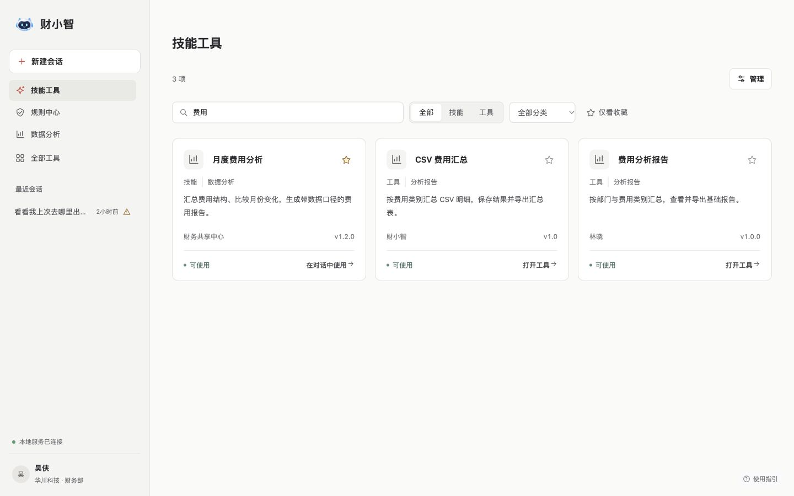

# 技能工具统一目录验收

日期：2026-11-17。用户恢复本地文件后，按已选定的“统一目录，技能和工具作为类型筛选”方案实施。

## 实施结果

- 日常查找和使用归统一目录，支持搜索、类型、业务分类和收藏。CSV 费用汇总进入普通目录。
- 维护与审核进入独立管理区域，按“我创建的／审核发布”组织。保留原有上传、版本、校验、审核、发布、分发与访问操作。
- 卡片、详情和工具外层统一使用现有灰白办公主题、字体层级及主操作色；上传用宽居中弹窗，详情用右侧抽屉。
- 教程、示例文件、示例操作与演示身份切换全部收进右下角默认关闭的“使用指引”。必要格式约束、权限反馈、错误及数据来源仍就近显示。
- 默认工具无文件、无结果；主动载入示例仅准备输入，明确执行后才计算。无效新文件不会沿用旧输入或结果。

## 自动检查

以下命令在最终代码上退出码均为 0：

```sh
node node_modules/typescript/bin/tsc -p apps/web/tsconfig.agent.json --noEmit
node apps/web/node_modules/vite/bin/vite.js build --config apps/web/vite.agent.config.ts
node node_modules/vitest/vitest.mjs run tests/unit/agent-skills-catalog.spec.ts tests/unit/agent-skill-selection.spec.ts tests/unit/agent-skill-package.spec.ts tests/unit/agent-skill-artifact.spec.ts tests/unit/agent-conversation-model.spec.ts
node --test --test-reporter=dot apps/web/public/demos/tool-center/*.test.mjs
```

前端 5 个测试文件共 60 项通过；旧工具 55 项通过。覆盖发布版本选择、权限与运行状态、收藏、筛选路由、草稿目标恢复、工具计算、错误输入及跨 iframe 上传草稿恢复。

构建成功，仍提示主包大于 500 kB；本轮未进行整应用拆包。曾出现其他并行修改期间的热更新错误，最终新开验收页面控制台无 error／warn，最终类型检查也通过。

Impeccable 扫描本轮目录、指引、详情及工具工作区组件返回空结果；搜索框焦点修正后的样式检查也未报告问题。该结果不替代下述实际页面走查。

## 浏览器验收

本地地址：`http://127.0.0.1:5190/agent.html#skills`。

| 范围 | 实际结果 |
| --- | --- |
| 1280 桌面 | 统一目录、工具详情、管理列表与运行页正常；没有旧工具内层目录与重复帮助 |
| 390 窄屏 | 目录单列、筛选换行；工具上传正文可滚动，关闭与保存操作可达，右下角指引可用 |
| 768 平板 | 技能上传完整居中表单、CSV 工作区与返回目录正常 |
| 1440 × 900 | 技能和工具可出现在同一搜索结果，卡片布局统一；焦点仅保留一层外框 |
| 上传中的帮助 | 打开并按 Escape 关闭指引，底层技能上传表单仍在 |
| 工具上传草稿 | 填写名称、关闭上传、重新打开，名称恢复；验收临时文字已清空，未保存或提交资产 |
| 示例 | 两表核对默认无输入与结果；从指引载入后显示示例来源及尚未执行，导出禁用 |
| 首页草稿 | 输入文字→进入目录→刷新→在对话中使用：返回首页，文字保留、技能选中，没有新增空会话 |
| 原会话草稿 | 输入文字→进入目录→刷新→在对话中使用：回到原会话，原消息与输入保留，没有自动发送 |
| 目录上下文 | 搜索 CSV→打开费用汇总→返回目录，搜索仍为 CSV；结果历史定位保留查询参数由代码复核确认 |

草稿测试使用的临时输入与已选技能已清回原空状态，未发送模型任务、审核或发布。附件保留由状态回归测试验证，本轮未为视觉验收新增上传附件。CSV 当前无历史结果，未声称实测了历史重开。

最终截图为搜索“费用”的统一结果，可同时看到技能与工具；交付页面已恢复全部目录，临时视口覆盖已重置。



## 独立审查及修复

- 选择技能原先可能创建空会话：改为仅更新明确草稿目标，保留文字、附件和消息。
- 工具上传退出 iframe 后原内存草稿丢失：按身份、资产和基准版本保存会话内草稿；提交成功只清对应草稿。
- CSV 打开结果会覆盖目录查询参数：改为只更新工具及结果定位字段。
- 原会话进入目录后刷新会丢目标：持久化进入目录时的会话 ID，同时明确保存“来自首页”的空目标，避免误绑旧会话；新增回归先失败后通过，并完成浏览器复核。

## 执行与权限边界

本轮统一产品入口和展示，不建设新授权系统。技能及原生 CSV 工具继续使用原有服务端能力；旧工具继续使用原本浏览器模型与演示角色，上传 HTML 的隔离保留。浏览器工具的活动摘要不是可恢复完整结果，也未新增其 Agent 调用能力。以上限制在指引与交付说明中如实保留。

大量现有未提交成果与其他任务并行修改均保留。本轮没有整仓重置、自动提交、推送或部署。
